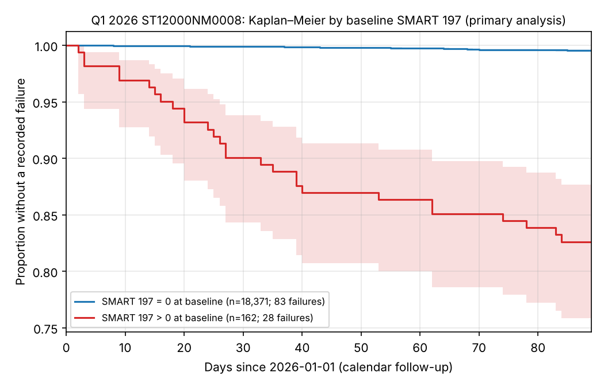

# Does a Pending-Sector Warning Predict Hard-Drive Failure?

A survival analysis of [Backblaze Drive Stats](https://www.backblaze.com/cloud-storage/resources/hard-drive-test-data), Q1 2026.

**Authors:** Aayush Jha, Ankit Roy, Faaz Noushad. Advanced Statistical Methods II, Indian Statistical Institute.

[Report (PDF)](report/ASM2_Group_Project_Report.pdf) · [Slides (PDF)](report/ASM2_Group_Project_Slides.pdf) · [Full results](docs/q1_survival_results.md)

## Question

Is a nonzero SMART 197 (Current Pending Sector Count) on a fixed baseline day associated with a later recorded drive failure?

## Data

- Official Backblaze Q1 2026 daily files: 30.6M drive-days, 351,095 drives, checksum-verified.
- Analysis cohort: **18,533 Seagate ST12000NM0008 drives** in service on 1 January 2026, followed by calendar day to 31 March 2026, with 111 recorded failures.
- No raw or drive-level data is committed. Scripts re-download and verify the source.

## Results



| Baseline SMART 197 | Drives | Failures | Survival to Mar 31 (95% CI) |
|---|---:|---:|---|
| = 0 | 18,371 | 83 | 0.9955 (0.9944–0.9964) |
| > 0 | 162 | 28 | 0.826 (0.758–0.877) |

- **Cox hazard ratio: 43.2 (95% CI 28.1–66.3).** After adjusting for powered-on age it is 43.6 (28.4–66.9).
- **The excess risk is concentrated early.** About 10% of flagged drives failed within 30 days. The proportional-hazards test rejects (p = 0.007), so the HR is a quarter-average, and the KM curves are the primary summary.
- **Robust to how exits and observation gaps are handled.** Both sensitivity analyses give essentially the same estimates.

## Method

1. **Audit the raw data before modelling.** This covered schema, model-label aliases, drives that disappear and reappear, and day-one failures that the daily logic does not capture.
2. **Construct a fixed-baseline cohort.** This handles left truncation (prevalent drives), administrative censoring, unexplained exits and observation gaps.
3. **Record the design decisions** (`docs/q1_decisions.json`) and the analysis plan (`docs/q1_analysis_plan.md`) **before** looking at event counts by group.
4. **Fit Kaplan–Meier and a Cox model** (Efron ties), with sensitivity analyses for exits and gaps, plus one age-adjusted secondary model. Every Cox fit is cross-checked between lifelines and statsmodels.

## Limitations

- The outcome is a *recorded* Backblaze failure. Backblaze counts SMART-triggered proactive replacements as failures, so this is an association, not a causal effect or a lifetime risk.
- The cohort is prevalent (drives already in service), with one drive model and one quarter.
- Small exposed group (162 drives), hence the wide confidence interval.
- The age adjustment uses powered-on hours (not installation age), and covers a narrow 5.5–6.2 year range.

## Reproduce

Python 3.11+.

```bash
python -m venv .venv && source .venv/bin/activate
python -m pip install -e '.[test]'
python -m pytest -q
python scripts/verify_outputs.py
```

Full pipeline: `scripts/run_data_audit.py` (data audit) → `scripts/build_cohort_skeleton.py` (cohort) → `scripts/link_q1_exits.py` (exit linkage) → `scripts/fit_q1_survival.py` and `scripts/fit_q1_age_adjusted.py` (models; pass `--check` to compare against the committed outputs). Source URLs and checksums are in `docs/source_q1_2026.json` and `docs/data_provenance.md`.

## Repository layout

```text
src/backblaze_audit/   audit, cohort, linkage and survival code
scripts/               entry points for each stage
tests/                 pytest suite
docs/                  analysis plan, decisions, provenance, results write-ups
results/               aggregate audit tables and survival outputs
report/                report and slides
```
