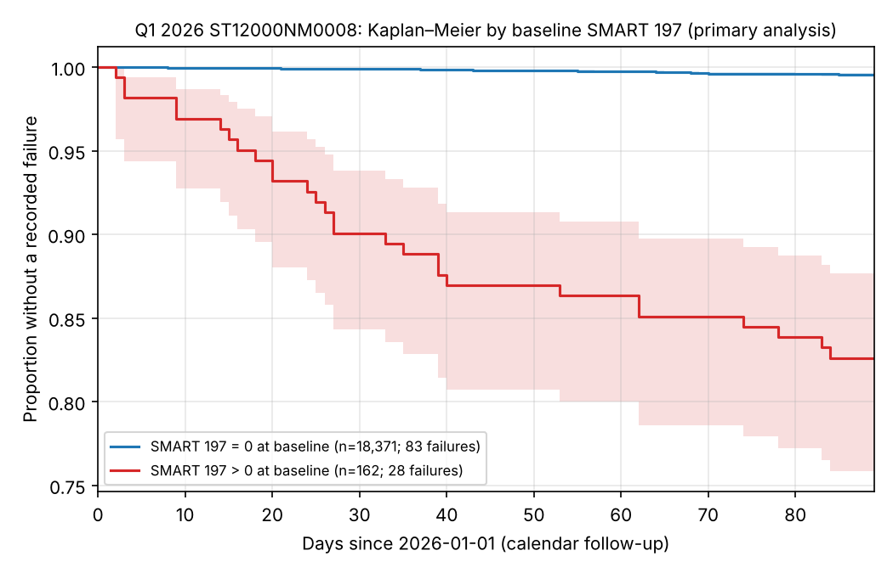

**Course:** Advanced Statistical Methods II, Indian Statistical Institute
(instructor: Dr. Monitirtha Dey).

## Abstract

We studied whether a SMART "pending sector" warning (SMART 197, Current Pending Sector
Count) on a fixed day is associated with a later recorded hard-drive failure. We used a
survival framework on Backblaze's public Drive Stats data.

- **Cohort:** 18,533 Seagate ST12000NM0008 drives in service on 1 January 2026,
  followed by calendar day to 31 March 2026.
- **Methods:** Kaplan–Meier curves by baseline SMART 197 status and a Cox
  proportional-hazards model. Exits and observation gaps get pre-specified sensitivity
  analyses, and a secondary model adjusts for powered-on age.
- **Results:**
  - Among the 162 drives with a nonzero baseline count, 28 had a recorded failure
    within 89 days. The estimated proportion without a recorded failure was 0.826
    (95% CI 0.758–0.877).
  - Among the 18,371 drives with a zero count, it was 0.9955 (0.9944–0.9964), with 83
    failures.
  - The Cox hazard ratio was **43.2 (95% CI 28.1–66.3)**, so we reject the null
    hypothesis of no association (Wald p ≈ 10⁻⁶⁶).
- **Robustness:** the result holds when exits are reclassified (HR 43.2), when gap
  days are removed (44.1), and when adjusting for powered-on years (43.6). Hazards
  were not proportional: most of the excess risk came in the first month.
- **Caveat:** Backblaze counts proactive replacements triggered by SMART indicators as
  failures. The association is therefore partly built into the outcome. It should not
  be read as a causal effect or as a validated prediction rule.

## 1. Introduction and hypotheses

Hard drives report self-monitoring (SMART) attributes, and data centres use them to
decide when to replace drives. SMART 197 counts sectors the drive could not read and
has marked as "pending" for reallocation. Our question, as approved in our project
proposal (6 October 2026), was:

> Is a pre-specified SMART health indicator associated with subsequent hard-drive
> failure, after accounting for drive age?

- **H₀:** the baseline SMART 197 status has no association with the subsequent
  failure hazard.
- **Hₐ:** the baseline SMART 197 status is associated with the subsequent failure
  hazard.

Survival analysis fits this question because drives are observed for different lengths
of time. Many drives never fail in the window (right censoring), and some leave
observation for reasons other than failure.

## 2. Background

- **SMART signals and failure.** Pinheiro, Weber and Barroso [6] studied more than
  100,000 drives at Google.
  - They found that a few SMART parameters "have a large impact on failure
    probability", including probational (pending) counts.
  - After the first probational count, drives were "16 times more likely to fail
    within 60 days" than drives with none.
  - They also found that over 56% of failed drives had no count in the four strongest
    SMART signals, so SMART-only models are "unlikely to be useful for predicting
    individual drive failures".
- **How Backblaze defines failure.** In Drive Stats a drive is recorded as failed
  when it is removed and replaced. That covers *reactive* failures, where the drive
  dies or stops responding. It also covers *proactive* failures, where "indicators such
  as SMART stats, FSCK checks, etc., signal that the drive is having difficulty and
  drive failure is highly probable" [7].
  - The public data records only a 0/1 failure flag, not its type [7].
  - In Q3 2024, 721 of Backblaze's 1,361 failures (53%) were proactive [7].
  - The Q3 2025 report describes failure monitoring through SMART attributes,
    including `Current_Pending_Sector` [8].

  This matters for interpretation (§7).

## 3. Data

**Source.** Backblaze Drive Stats, Q1 2026: 90 daily CSV files, 1 January to 31 March
2026, 30.6 million drive-days in total [9]. The archive's SHA1 and every file's CRC32
match the published values. No raw data is stored in the project repository.

**Choice of drive model.** We restricted the study to one model, Seagate
`ST12000NM0008` (12 TB), so that manufacturer and firmware differences don't confound
the comparison. Q1 has 18,650 such drives and 129 failure flags.

**Cohort construction.** Baseline is 1 January 2026 (day 0).

- **Included:** drives present on that day.
- **Excluded:** drives first seen later (116 drives, 17 of them with failures) and one
  drive whose failure flag fell on the baseline day.

That leaves **18,533 drives and 111 recorded failures**. Data checks:

- There are no duplicate drive-day records, and no rows after a failure.
- Baseline SMART 197, SMART 5 and SMART 9 were present for every included drive.

**Outcome and censoring.**

- **Event:** the first `failure = 1` flag after baseline, dated on the flag day.
- **Censoring:**
  - Drives still present on 31 March are censored there.
  - 96 drives disappeared earlier without a flag. They are censored at their last
    observed day and never counted as failures.
- **Gaps:** 10.2% of drives have at least one gap in observation. The share is 22%
  among SMART 197 > 0 drives and 10% among SMART 197 = 0 drives.

**Exposure.** SMART 197 raw > 0 versus = 0, taken from the 1 January record only: 162
drives versus 18,371. Later values are never used, so the exposure cannot "see the
future".

**Table 1. Cohort accounting (included drives).**

| Baseline SMART 197 | Drives | Recorded failures | Censored 31 Mar | Unexplained exits |
|---|---:|---:|---:|---:|
| = 0 | 18,371 | 83 | 18,195 | 93 |
| > 0 | 162 | 28 | 131 | 3 |
| Total | 18,533 | 111 | 18,326 | 96 |

## 4. Methods

**Time scale.** Calendar days since 1 January 2026, from 0 to 89. This is a prevalent
cohort. Drives entered service before 2026, and their installation dates are unknown.

**Kaplan–Meier estimator** [1], with 95% pointwise confidence intervals from
Greenwood's variance [3] on the log(−log) scale. We report survival at days 30, 60 and
89.

**Cox proportional-hazards model** [2]: hazard *h(t | x) = h₀(t)·exp(βx)*, where *x*
indicates baseline SMART 197 > 0.

- Tied failure days are handled with Efron's method [4].
- We test H₀: β = 0 with the Wald test.
- Proportional hazards are checked with the scaled-Schoenfeld-residual test of
  Grambsch and Therneau [5]. The test is reported, but it was not used to change the
  model.

**Pre-specified sensitivity analyses.**

- **S1 (exits).** A bounded check of 1–14 April 2026 found that 93 of the 96 exits
  reappeared. In S1 those drives are censored at day 89 instead of their last Q1 day.
- **S2 (gaps).** Days a drive was missing are removed from the risk set, using
  start–stop (counting-process) intervals.

**Secondary analysis: adjustment for age.** Drive installation dates are not
published. SMART 9 counts powered-on hours, so we used baseline SMART 9 ÷ 8,766 as
"powered years", a proxy for age. We fitted one extra Cox model with SMART 197 status
plus a linear powered-years term. It was specified and committed before fitting, and
added after the primary plan to honour the "after accounting for drive age" in our
proposal.

**Safeguards against data-driven choices.** Before anyone looked at failure counts by
group, we committed to the repository:

- the decision rule for using SMART 197 rather than SMART 5 (keep 197 if its nonzero
  group had at least 10 failures);
- the censoring and gap conventions;
- the full analysis plan.

**Software.** Python 3.13, lifelines 0.30.0 [10] and statsmodels 0.15.0 [11].

- Every Cox coefficient was cross-checked between the two packages and agreed to
  within 10⁻⁶.
- Damped Newton steps were needed, because the rare exposure and strong effect made
  full steps from β = 0 overflow.

## 5. Results

{ width=95% }

**Table 2. Kaplan–Meier estimates (primary analysis), with 95% CI.**

| Group | Day 30 | Day 60 | Day 89 |
|---|---|---|---|
| SMART 197 = 0 | 0.9989 (0.9982–0.9993) | 0.9976 (0.9968–0.9982) | 0.9955 (0.9944–0.9964) |
| SMART 197 > 0 | 0.9007 (0.8431–0.9380) | 0.8635 (0.8001–0.9079) | 0.8262 (0.7583–0.8766) |

Drives at risk on days 0, 30, 60 and 89:

- SMART 197 = 0: 18,371; 18,349; 18,324; 18,195
- SMART 197 > 0: 162; 145; 139; 131

**Table 3. Cox models: hazard ratio for baseline SMART 197 > 0 versus = 0.**

| Analysis | HR | 95% CI | Wald p | PH test p |
|---|---:|---|---|---|
| Primary | **43.2** | 28.1–66.3 | 1.7 × 10⁻⁶⁶ | 0.0069 |
| S1: exits reclassified | 43.2 | 28.1–66.3 | 1.7 × 10⁻⁶⁶ | 0.0069 |
| S2: gap days removed | 44.1 | 28.7–67.7 | 3.5 × 10⁻⁶⁷ | — |
| Adjusted for powered years | 43.6 | 28.4–66.9 | 9.5 × 10⁻⁶⁷ | 0.0070 |

S2 has no PH test, because lifelines provides none for start–stop fits.

**Age-adjusted model.**

- Powered years have a hazard ratio of 1.11 per year (95% CI 0.85–1.43, p = 0.44),
  with no PH violation (p = 0.92).
- Almost all drives are 5.5–6.2 powered years old. The median is 5.73 in the zero
  group and 6.00 in the nonzero group.

**Decision on the hypotheses.** At the 5% level we reject H₀: baseline SMART 197
status is associated with the subsequent hazard of a recorded failure. This holds both
without and with adjustment for powered-on age.

**Shape of the effect.** About 10% of drives with SMART 197 > 0 had a recorded
failure within 30 days, and about 4% in each later 30-day span. The PH test rejects a
constant hazard ratio (p = 0.007). The HR of 43 is therefore an average over the
quarter, larger early and smaller later, and the Kaplan–Meier curves are the more
faithful summary.

**In absolute terms.** About 17 in 100 drives with a pending-sector warning had a
recorded failure within three months, against fewer than 1 in 200 without one. The
warning group is under 1% of the fleet, but it accounts for 25% of the failures (28 of
111).

## 6. Discussion

The direction and size of the association are in line with Pinheiro et al. [6]. They
found that drives with probational counts were 16 times more likely to fail within 60
days. Our larger hazard ratio may reflect several differences:

- the different outcome definition;
- the strong early hazard;
- one drive model;
- a fixed-baseline comparison rather than "after the first event".

The result is robust to every pre-specified sensitivity analysis and to adjustment for
powered-on age. Our exit check showed that 93 of 96 apparent exits were temporary gaps
in the data, not departures from the fleet.

## 7. Limitations

1. **The outcome is partly defined by SMART signals.** Backblaze records proactive,
   SMART-informed replacements as failures [7], and the public flag doesn't say which
   kind. Part of the association therefore reflects the operator's replacement policy
   acting on warnings such as SMART 197, not spontaneous mechanical failure. The two
   can't be separated with these data.
2. **Prevalent cohort, left truncation, no true age.** Installation dates are unknown.
   Powered-on hours are a proxy, and they vary over a narrow range here, so the age
   adjustment rules out confounding by age only within that range.
3. **Recording of failure dates.** Dates are daily snapshot dates. 21 of the 44
   failures that followed a gap were flagged on the day the drive reappeared, so
   recorded dates may lag true failure.
4. **Informative exits.** 4 drives that left Q1 carried a failure flag in early April.
5. **Overlap with other warnings.** 110 of the 162 SMART 197 > 0 drives also had
   reallocated sectors (SMART 5 > 0). The HR is not specific to pending sectors.
6. **Scope.** One drive model, one quarter and 28 exposed failures, hence wide
   confidence intervals. No other covariates were available or planned.

## 8. Conclusion

For Seagate ST12000NM0008 drives in service on 1 January 2026, a nonzero pending-sector
count marked a small group, under 1% of drives, with a far higher three-month rate of
recorded failure: HR 43.2, or 43.6 after adjustment for powered-on age. The excess was
concentrated in the first weeks and was robust to how exits, gaps and age were
handled. Because Backblaze counts SMART-informed replacements as failures, this is
best stated as a strong association between SMART 197 and recorded
removal-or-failure. It is not evidence that pending sectors cause failure, nor a
validated prediction rule.

## References

1. Kaplan, E. L. & Meier, P. (1958). Nonparametric estimation from incomplete
   observations. *JASA*, 53, 457–481.
2. Cox, D. R. (1972). Regression models and life-tables. *JRSS B*, 34, 187–220.
3. Greenwood, M. (1926). The natural duration of cancer. *Reports on Public Health
   and Medical Subjects*, 33, HMSO.
4. Efron, B. (1977). The efficiency of Cox's likelihood function for censored data.
   *JASA*, 72, 557–565.
5. Grambsch, P. M. & Therneau, T. M. (1994). Proportional hazards tests and
   diagnostics based on weighted residuals. *Biometrika*, 81, 515–526.
6. Pinheiro, E., Weber, W.-D. & Barroso, L. A. (2007). Failure trends in a large disk
   drive population. *Proc. 5th USENIX FAST*, 17–28.
7. Backblaze (2024). Backblaze Drive Stats for Q3 2024.
   https://www.backblaze.com/blog/backblaze-drive-stats-for-q3-2024/
8. Backblaze (2025). Backblaze Drive Stats for Q3 2025.
   https://www.backblaze.com/blog/backblaze-drive-stats-for-q3-2025/
9. Backblaze. Hard Drive Data and Stats (Q1 2026 archive).
   https://www.backblaze.com/cloud-storage/resources/hard-drive-test-data
10. Davidson-Pilon, C. (2019). lifelines: survival analysis in Python. *Journal of
    Open Source Software*, 4(40), 1317.
11. Seabold, S. & Perktold, J. (2010). statsmodels: econometric and statistical
    modeling with Python. *Proc. 9th Python in Science Conference*.

## Appendix: reproducibility

All code, tests, decisions and outputs are in the project repository
`aayush-0131/backblaze-survival-analysis`. Raw and drive-level data are never
committed.

**Order of the safeguards (UTC):**

- 2026-11-10 20:59: decision rules recorded before the per-group counts were read.
- 2026-11-10 21:00: per-group counts opened.
- 2026-11-10 21:05: primary analysis plan recorded before fitting.
- 2026-11-10 21:16: primary results.
- 2026-11-11 14:58: age-adjusted plan recorded before fitting.
- 2026-11-11 15:03: age-adjusted results.

The cohort was rebuilt independently from a freshly downloaded, hash-verified archive
and reproduced byte for byte. The test suite (49 tests) passes.

To reproduce, download the Q1 ZIP to `data/raw/`, then run:

```
PYTHONPATH=src python scripts/build_cohort_skeleton.py --zip-path data/raw/data_Q1_2026.zip --expect-manifest results/audit/data_manifest.json --output-dir data/processed/q1_cohort
PYTHONPATH=src python scripts/fit_q1_age_adjusted.py --check
PYTHONPATH=src python scripts/fit_q1_survival.py --zip-path data/raw/data_Q1_2026.zip --check
```

The last command also needs the April exit-linkage output (`scripts/link_q1_exits.py`).
